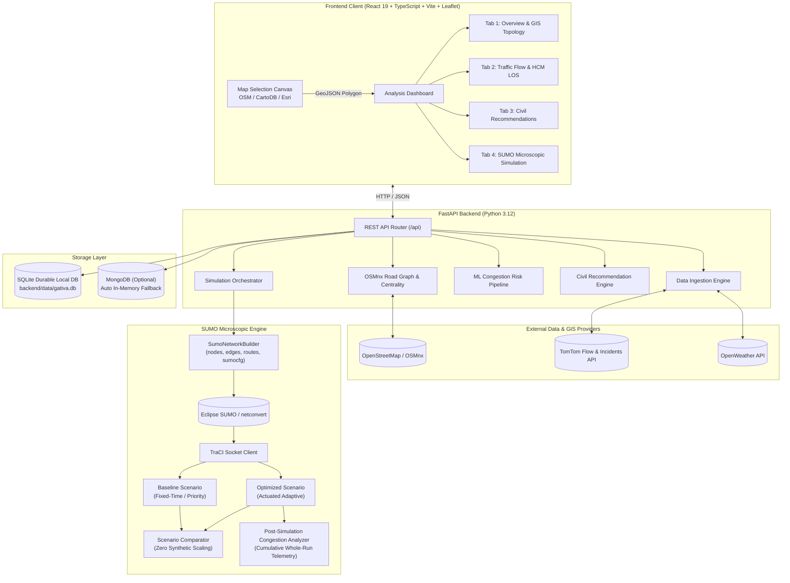
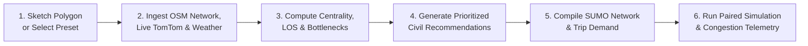

# 🚦 Gativa — Smart Traffic Analysis, Infrastructure Optimization & SUMO Simulation Platform

[](https://fastapi.tiangolo.com)
[](https://react.dev)
[](https://vitejs.dev)
[](https://leafletjs.com)
[](https://eclipse.dev/sumo/)
[](https://tailwindcss.com)
[](https://github.com/Sujalkan07/Gativa)

> **Gativa** is a full-stack, AI/ML-driven geospatial intelligence and microscopic traffic simulation platform built for municipal civil engineers, urban transport planners, and GIS analysts. It diagnoses real-world road network bottlenecks, evaluates evidence-backed infrastructure interventions, scores congestion risks, and executes microscopic traffic simulations with honest, empirical telemetry using **Eclipse SUMO** and **TraCI**.

---

## 📑 Table of Contents

- [Core Highlights](#-core-highlights)
- [System Architecture](#-system-architecture)
- [How Gativa Works (End-to-End Workflow)](#-how-gativa-works-end-to-end-workflow)
- [Dashboard Walkthrough (4 Analytical Tabs)](#-dashboard-walkthrough-4-analytical-tabs)
- [SUMO Simulation Subsystem & Technical Honesty](#-sumo-simulation-subsystem--technical-honesty)
- [Post-Simulation Road-Level Congestion Analysis](#-post-simulation-road-level-congestion-analysis)
- [Machine Learning & Feature Engineering](#-machine-learning--feature-engineering)
- [Quickstart Guide (Local Setup)](#-quickstart-guide-local-setup)
- [Environment Configuration & API Keys](#-environment-configuration--api-keys)
- [API Reference Cheatsheet](#-api-reference-cheatsheet)
- [Automated Testing & Verification](#-automated-testing--verification)
- [Repository Structure](#-repository-structure)
- [Design System & Tokens](#-design-system--tokens)
- [Civil Engineering & Privacy Disclaimer](#-civil-engineering--privacy-disclaimer)

---

## 🌟 Core Highlights

- **🗺️ Zero Proprietary Map Dependencies**: Interactive geospatial polygon sketch canvas powered entirely by OpenStreetMap, CartoDB Voyager, and Esri World Imagery. No credit cards, proprietary Google Maps billing, or API lock-in required.
- **🔬 Microscopic Traffic Simulation (Eclipse SUMO + TraCI)**: Compiles road networks into native SUMO topologies with UTM projections, routable vehicle demand, and live socket control via TraCI.
- **⚡ Dual Independent Simulation Architecture**: Simultaneously executes an **Optimized Scenario** (Actuated Adaptive Signal Control) alongside an identical **Baseline Scenario** (Pre-Timed Fixed Signal or Unsignalized Priority Control) without fabricated numbers or scalar multipliers.
- **🚦 Traffic Control Authenticity & Provenance**: Strict preservation of infrastructure ground-truth (`source_verified`, `source_inferred`, `simulation_assumption`). Genuine zero-signal networks simulate authentically under priority right-of-way rules.
- **📊 Post-Simulation Road-Level Congestion Analysis**: Continuous, whole-run cumulative TraCI telemetry evaluates speeds, lane occupancy, halting queues, and waiting times across every road segment, visualizing congestion severity directly on the Leaflet map.
- **⏩ Smooth Playback & True Multipliers (1x, 2x, 5x)**: Chained 5 FPS cadence loop paired with batched TraCI telemetry provides responsive, smooth vehicle animation with zero frame drops.
- **🤖 Explainable Machine Learning**: Classifies congestion risk using Random Forest & Logistic Regression models trained on graph betweenness centrality, lane density, and geometric capacity.
- **💡 Evidence-Backed Civil Recommendations**: Delivers prioritized infrastructure interventions (Signal Optimization, Roundabouts, Road Widening, One-Way Circulation) with confidence scores and mandatory civil review warnings.

---

## 🏗️ System Architecture



---

## 🚦 How Gativa Works (End-to-End Workflow)



1. **Polygon Selection (`/`)**: Sketch an arbitrary urban polygon using Leaflet drawing tools or click one of the pre-configured urban corridors (e.g., Lucknow Jankipuram, Bengaluru Silk Board, Mumbai BKC, Delhi Connaught Place).
2. **Data Ingestion & Synthesis**:
   - Downloads real street network topology from OpenStreetMap using OSMnx.
   - Queries TomTom Traffic Flow and Incident feeds for real-time roadway speeds and incident alerts.
   - Fetches microclimate weather telemetry (temperature, precipitation, wind) from OpenWeather.
3. **Graph & Centrality Analysis**:
   - Calculates NetworkX betweenness centrality and node degrees to locate structural network bottlenecks.
   - Computes Highway Capacity Manual (HCM 6th Edition) Level of Service (LOS A through F) for every street.
4. **Machine Learning Risk Scoring**:
   - Evaluates road segment feature vectors to predict congestion vulnerability.
5. **Civil Recommendation Generation**:
   - Produces prioritized, evidence-backed civil engineering proposals with impact scores and schematic guidelines.
6. **Microscopic SUMO Simulation**:
   - Compiles UTM-projected nodes, edges, routes, and traffic light logics into native SUMO XML networks.
   - Steps dual simulation runs via TraCI, rendering speed-coded vehicle markers and active traffic signal phase states on the map canvas.
   - Analyzes road-level congestion across the full simulation run.

---

## 🖥️ Dashboard Walkthrough (4 Analytical Tabs)

### Tab 1: Analysis Overview
- **6 Macroscopic KPI Cards**: Network Length, Total Intersections, Critical Bottlenecks, Average Network Speed, Congestion Index, and Microclimate Weather.
- **GIS Topology Map**: Interactive Leaflet canvas rendering road segments color-coded by functional hierarchy (Highways in Saffron, Arterials in Navy, Local in Slate) with interactive problem markers at critical junctions.
- **Functional Classification Distribution**: Recharts breakdown of road types and lane capacities.
- **Top Structural Bottlenecks**: Prioritized list of intersections based on betweenness centrality and capacity constraints.

### Tab 2: Traffic Flow & Level of Service (LOS)
- **HCM 6th Edition Speed Gradient Map**: Polylines dynamically colored by Level of Service:
  - 🟢 **LOS A–B** (Free Flow: Speed Ratio $\ge 80\%$)
  - 🟡 **LOS C–D** (Moderate Delay: Speed Ratio $50\% - 80\%$)
  - 🔴 **LOS E–F** (Severe Congestion: Speed Ratio $< 50\%$)
- **Live Speed Ratio Matrix**: Directional speed comparisons against free-flow baseline limits.
- **Incident Stream**: Real-time hazard alerts, road closures, and construction feeds from TomTom.

### Tab 3: Infrastructure Recommendations
- **Categorized Interventions**: Signal Optimization, Roundabout Conversion, Geometric Redesign, Road Widening, and One-Way Channelization.
- **Evidence-Based Scoring**: Every recommendation specifies priority score, confidence level, impacted segment IDs, supporting evidence, and a mandatory civil engineering review notice.
- **Interactive Schematics**: Geometric schematics and design criteria for intersection improvements.

### Tab 4: SUMO Microscopic Simulation
- **Live Simulation Canvas**: Vehicle markers moving along real OSM corridor coordinates, colored by speed (Flowing $> 35\text{ km/h}$, Moderate $18-35\text{ km/h}$, Congested $< 18\text{ km/h}$, Bus Transit in Brand Navy).
- **Signal Control Phase Visualizer**: Real-time traffic light markers reflecting TraCI phase states (Green, Yellow, Red) and controlled lanes.
- **Playback Controls**: Play, Pause, Resume, Step, Reset, and **1x / 2x / 5x Speed Multipliers**.
- **Side-by-Side Empirical Comparison**: Baseline vs. Optimized scenario variance table (Average Speed, Waiting Time, Queue Length, Completed Throughput).
- **Post-Simulation Road Congestion View**: Recolors streets by cumulative congestion severity with full telemetry inspection tooltips.
- **Signal Inspection & Scenario Editor**: Inspect controlled links, review junction safety notes, and switch individual intersection controls between fixed-time, actuated adaptive, and unsignalized priority right-of-way.

---

## 🚗 SUMO Simulation Subsystem & Technical Honesty

Gativa adheres to strict engineering honesty principles: **the system never fabricates infrastructure or invents improvements.**

| Principle | Gativa Implementation |
| :--- | :--- |
| **No Inferred Signals** | A junction is never classified as a traffic light simply because its degree is $\ge 3$. Signals are only compiled if verified by OSM ground-truth tags (`highway=traffic_signals`) or explicit user interventions. |
| **Authentic Zero-Signal Networks** | When an analyzed corridor has 0 verified signals, Gativa compiles native priority right-of-way rules. The UI displays an explicit "Unsignalized Road Network" diagnostic banner. |
| **Control Provenance Tracking** | Every traffic control element carries an explicit provenance tag: `source_verified` (ground-truth OSM), `source_inferred` (corroborated infrastructure data), or `simulation_assumption` (synthetic test corridor or user intervention). |
| **Dual Independent Runs** | Baseline and Optimized scenarios are independently executed on identical topologies and random seeds (`42`). Variance is measured directly from runtime samples: $\Delta \% = \frac{\text{Optimized} - \text{Baseline}}{\text{Baseline}} \times 100$. No artificial scalar multipliers are ever used. |
| **Transparent Engine Modes** | `native_sumo` (Eclipse SUMO via TraCI socket) vs. `fallback` (deterministic physics engine along corridor polylines). The active engine mode is visibly badged in the UI with diagnostic explanations. |
| **Full-Run Telemetry** | Edge telemetry accumulates across the entire simulation duration (`_edge_cumulative_stats`), ensuring congestion analysis reflects the full run rather than a truncated rolling buffer. |

---

## 📈 Post-Simulation Road-Level Congestion Analysis

At the conclusion of a simulation run (or on demand), Gativa evaluates road-level congestion from TraCI edge telemetry:

$$\text{Congestion Score} = 0.5 \times (1 - \text{Speed Ratio}) + 0.3 \times \left(\frac{\text{Occupancy}\%}{100}\right) + 0.2 \times \left(\frac{\text{Halting Vehicles}}{5.0}\right)$$

### Congestion Severity Classification

| Severity Level | Score Range | Color Code | Description |
| :--- | :---: | :---: | :--- |
| **Free Flow** | $< 0.20$ | `#10B981` | Unrestricted flow at or near posted speed limit |
| **Low Congestion** | $0.20 - 0.40$ | `#84CC16` | Minor slowing, minimal approach queues |
| **Moderate Congestion** | $0.40 - 0.60$ | `#F59E0B` | Reduced speeds, noticeable queue spillback |
| **High Congestion** | $0.60 - 0.80$ | `#EF4444` | Severe queuing, extensive vehicle delay |
| **Severe Congestion** | $\ge 0.80$ | `#7F1D1D` | Complete gridlock, breakdown of throughput |
| **Insufficient Data** | $< 3\text{ obs}$ | `#94A3B8` | Too few telemetry observations for statistical validity |

---

## 🤖 Machine Learning & Feature Engineering

Gativa includes a reproducible feature engineering and classification pipeline:

- **Features Extracted**:
  - `length_m`: Segment physical length in meters.
  - `lanes`: Total directional lane capacity.
  - `speed_limit_kmh`: Posted speed limit.
  - `road_type_encoded`: Ordinal encoding (Highway > Arterial > Collector > Local).
  - `betweenness_centrality`: NetworkX shortest-path graph centrality.
  - `degree_centrality`: Node degree at segment termination points.
  - `free_flow_ratio`: Ratio of observed speed to free-flow reference velocity.
- **Model Training & Validation**:
  - Compares **Random Forest Classifier** against **Logistic Regression** baseline.
  - Evaluated on an independent, held-out validation split with zero data leakage.
  - Run the calibration report:
    ```bash
    cd backend
    .\venv\Scripts\python.exe -m app.ml.train_evaluate
    ```

---

## ⚡ Quickstart Guide (Local Setup)

### Prerequisites

- **Python**: Version `3.10` or higher (`3.12` recommended)
- **Node.js**: Version `18.x` or higher (`20+` recommended)
- **Eclipse SUMO** *(Optional for native simulation, fallback kinematics included)*: [Download Eclipse SUMO](https://eclipse.dev/sumo/)

---

### Step 1: Clone Repository

```bash
git clone https://github.com/Sujalkan07/Gativa.git
cd Gativa
```

---

### Step 2: Backend Setup (FastAPI)

```bash
# Navigate to backend directory
cd backend

# Create and activate Python virtual environment
# Windows (PowerShell):
python -m venv venv
.\venv\Scripts\Activate.ps1
# macOS / Linux:
# python3 -m venv venv
# source venv/bin/activate

# Install dependencies
pip install -r requirements.txt

# Create environment configuration
copy .env.example .env
# (On macOS/Linux: cp .env.example .env)

# Start the backend server (runs on port 8000)
python run_server.py
```

- **Interactive API Documentation (Swagger)**: [`http://localhost:8000/docs`](http://localhost:8000/docs)
- **Health Endpoint**: [`http://localhost:8000/api/health`](http://localhost:8000/api/health)

---

### Step 3: Frontend Setup (React + Vite)

Open a **new terminal**:

```bash
# Navigate to frontend directory
cd frontend

# Install Node dependencies
npm install

# Create environment configuration
copy .env.example .env
# (On macOS/Linux: cp .env.example .env)

# Start the Vite development server
npm run dev
```

- **Application URL**: [`http://localhost:5173`](http://localhost:5173)

---

## 🔑 Environment Configuration & API Keys

### Backend (`backend/.env`)

```dotenv
# Port & Environment
ENVIRONMENT=development
CORS_ORIGINS=http://localhost:5173,http://localhost:3000

# Geographic Constraints
MAX_AREA_KM2=50.0

# Database Persistence (SQLite is durable default; MongoDB is optional)
MONGODB_URI=mongodb://localhost:27017
DATABASE_NAME=gativa

# Live Traffic Telemetry (Free tiers available)
TOMTOM_API_KEY=your_tomtom_api_key_here
OPENWEATHER_API_KEY=your_openweather_api_key_here
```

### Obtaining Free API Keys

1. **TomTom Developer API Key** *(Traffic Flow & Incidents)*:
   - Sign up at [developer.tomtom.com](https://developer.tomtom.com/).
   - Create an app and copy your free API key into `backend/.env`.
2. **OpenWeather API Key** *(Current Microclimate Weather)*:
   - Sign up at [home.openweathermap.org/api_keys](https://home.openweathermap.org/api_keys).
   - Generate a free "Current Weather Data" key and copy it into `backend/.env`.
3. **OpenStreetMap & CartoDB**:
   - **Zero keys required.** Gativa uses CartoDB Voyager and Esri World Imagery basemaps with compliant public attribution.

---

## 📡 API Reference Cheatsheet

| Method | Endpoint | Description |
| :--- | :--- | :--- |
| `GET` | `/api/health` | Service health status, provider readiness & warnings |
| `POST` | `/api/analyses` | Submit GeoJSON polygon for analysis |
| `GET` | `/api/analyses/{id}` | Retrieve comprehensive analysis summary |
| `GET` | `/api/analyses/{id}/traffic-flow` | Fetch TomTom live flow, LOS gradients & incidents |
| `GET` | `/api/analyses/{id}/recommendations` | Get prioritized civil engineering interventions |
| `GET` | `/api/analyses/{id}/export/geojson` | Export road network and bottlenecks as GeoJSON |
| `POST` | `/api/simulations/prepare` | Compile SUMO dual network & trip demand |
| `POST` | `/api/simulations/{id}/start` | Launch or resume TraCI simulation |
| `POST` | `/api/simulations/{id}/pause` | Pause active simulation |
| `POST` | `/api/simulations/{id}/step?steps={n}` | Advance simulation by $n$ steps and retrieve vehicles |
| `POST` | `/api/simulations/{id}/reset` | Reset simulation to timestamp 0 |
| `POST` | `/api/simulations/{id}/stop` | Terminate session and release SUMO sockets |
| `GET` | `/api/simulations/{id}` | Query current simulation metrics & vehicle coordinates |
| `GET` | `/api/simulations/{id}/comparison` | Retrieve Baseline vs. Optimized scenario comparison |
| `GET` | `/api/simulations/{id}/congestion` | Get road-level post-simulation congestion scores |
| `GET` | `/api/simulations/{id}/baseline` | Query baseline regular scenario status |
| `GET` | `/api/simulations/{id}/signals` | Inspect traffic signals, controlled lanes & movements |
| `POST` | `/api/simulations/{id}/signals/{tl_id}/edit` | Modify signal control plan or convert to priority |
| `POST` | `/api/simulations/{id}/signals/reset` | Restore original signal configurations |

---

## 🧪 Automated Testing & Verification

Gativa includes a comprehensive test suite covering GIS accuracy, ML pipelines, SUMO network builders, TraCI lifecycles, and signal authenticity:

```bash
# Run full backend test suite (46+ tests)
cd backend
.\venv\Scripts\python.exe -m pytest -v

# Run dedicated simulation & signal authenticity tests
.\venv\Scripts\python.exe -m pytest tests/test_simulation.py tests/test_signal_authenticity.py -v

# Run frontend production build & linter
cd ../frontend
npm run lint
npm run build
```

---

## 📂 Repository Structure

```
Gativa/
├── frontend/                                # React 19 + TypeScript Frontend
│   ├── src/
│   │   ├── api/
│   │   │   └── client.ts                    # Typed Axios client & error mapping
│   │   ├── components/
│   │   │   ├── Header.tsx                   # Stitch design top navigation
│   │   │   ├── selection/
│   │   │   │   └── LeafletDrawingMap.tsx    # Leaflet drawing canvas & presets
│   │   │   └── dashboard/
│   │   │       ├── AnalysisMap.tsx          # GIS road network Leaflet canvas
│   │   │       ├── AnalysisOverviewTab.tsx  # Tab 1: KPI cards, Recharts, bottlenecks
│   │   │       ├── TrafficFlowTab.tsx       # Tab 2: HCM LOS flow & TomTom telemetry
│   │   │       ├── RecommendationsTab.tsx   # Tab 3: Civil interventions & schematics
│   │   │       └── SumoSimulationTab.tsx    # Tab 4: SUMO TraCI simulation & congestion
│   │   ├── pages/
│   │   │   ├── MapSelectionPage.tsx         # Route /: Polygon drawing & validation
│   │   │   └── AnalysisDashboardPage.tsx    # Route /analysis/:id: 4-tab dashboard
│   │   ├── types/
│   │   │   └── api.ts                       # Shared TypeScript API schemas
│   │   ├── App.tsx                          # React Router definitions
│   │   ├── index.css                        # Tailwind v4 Gativa design tokens
│   │   └── main.tsx                         # Client application entry point
│   ├── package.json
│   └── vite.config.ts
│
├── backend/                                 # FastAPI Python Backend
│   ├── app/
│   │   ├── api/
│   │   │   ├── health.py                    # Health & provider diagnostics
│   │   │   ├── analyses.py                  # Analysis lifecycle & GeoJSON export
│   │   │   └── simulations.py               # SUMO simulation & signal endpoints
│   │   ├── core/
│   │   │   ├── config.py                    # Pydantic Settings
│   │   │   ├── database.py                  # Async MongoDB client with memory fallback
│   │   │   └── sqlite_store.py              # SQLite durable local persistence
│   │   ├── data_ingestion/
│   │   │   ├── tomtom.py                    # TomTom Traffic Flow & Incidents adapter
│   │   │   └── openweather.py               # OpenWeather adapter
│   │   ├── features/
│   │   │   └── pipeline.py                  # Road segment feature engineering
│   │   ├── geospatial/
│   │   │   └── road_network.py              # OSMnx road extraction & node control tags
│   │   ├── ml/
│   │   │   ├── classifier.py                # Congestion classification models
│   │   │   └── train_evaluate.py            # Model calibration & reporting
│   │   ├── models/
│   │   │   └── schemas.py                   # Pydantic validation & response models
│   │   ├── recommendations/
│   │   │   └── engine.py                    # Evidence-based recommendation engine
│   │   ├── services/
│   │   │   └── analysis.py                  # Analysis pipeline orchestration
│   │   └── simulation/
│   │       ├── network_builder.py           # SUMO network & route XML compiler
│   │       ├── traci_manager.py             # TraCI socket client & actuated controllers
│   │       ├── scenario_comparator.py       # Empirical scenario variance evaluator
│   │       └── service.py                   # Simulation session manager
│   ├── tests/                               # 46 Automated unit & integration tests
│   ├── run_server.py                        # Dual-stack IPv4/IPv6 FastAPI server runner
│   ├── main.py                              # FastAPI application entry point
│   └── requirements.txt                     # Python dependencies
│
└── README.md
```

---

## 🎨 Design System & Tokens

Gativa is designed in alignment with the **Stitch UI Design System** using an Indian urban infrastructure palette:

| Token | Hex | Role & Purpose |
| :--- | :---: | :--- |
| **Saffron** | `#FF9933` | Primary action buttons, active drawing polygon, highway indicators |
| **Brand Navy** | `#0A1145` | Main chrome, top header, primary card typography, bus transit icons |
| **India Green** | `#138808` | Free-Flow Level of Service (LOS A–B), verified status badges, play button |
| **Congestion Crimson** | `#DC2626` | Severe bottlenecks (LOS E–F), halting queue markers, hazard indicators |
| **Delay Amber** | `#F59E0B` | Moderate traffic delay (LOS C–D), warning banners, yellow phases |
| **Surface Canvas** | `#F8F9FF` | Clean analytical daylight workspace canvas |

---

## 🔒 Civil Engineering & Privacy Disclaimer

- **Zero User Tracking**: Access is immediate. No accounts, cookies, or personal tracking are required.
- **Secret Hygiene**: All external credentials remain strictly confined to `backend/.env` and are never exposed in client bundles.
- **Civil Engineering Notice**: Simulation metrics and automated recommendations are computational decision-support tools. They must be validated through formal on-site warrant studies, turning-movement counts, and professional civil engineering review before physical construction or capital expenditure.

---

## 📄 License

This project is licensed under the MIT License — see the repository for details.
