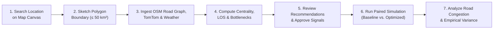
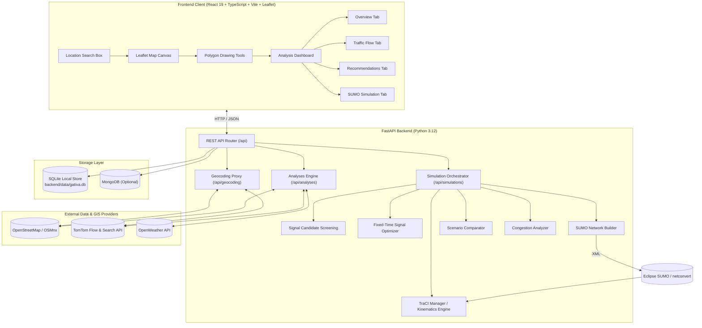

# 🚦 Gativa — Smart Traffic Analysis, Infrastructure Recommendation & SUMO Simulation Platform

[](https://fastapi.tiangolo.com)
[](https://react.dev)
[](https://vitejs.dev)
[](https://leafletjs.com)
[](https://eclipse.dev/sumo/)
[](https://tailwindcss.com)
[](https://github.com/Sujalkan07/Gativa)

> **Gativa** is an open-source, full-stack geospatial intelligence and microscopic traffic simulation platform designed for municipal civil engineers, urban transport planners, and GIS researchers. It enables users to search locations, sketch road networks, evaluate Level of Service (HCM 6th Edition), diagnose structural bottlenecks, review evidence-based physical infrastructure recommendations, and execute authentic microscopic traffic simulations using **Eclipse SUMO** and **TraCI** with zero synthetic data fabrication.

---

## 📑 Table of Contents

1. [Project Overview & Honest Scope](#1-project-overview--honest-scope)
2. [Project Status](#2-project-status)
3. [Core Features](#3-core-features)
4. [User Workflow Overview](#4-user-workflow-overview)
5. [Dashboard Analytical Tabs](#5-dashboard-analytical-tabs)
6. [Map Selection & Location Search](#6-map-selection--location-search)
7. [System Architecture](#7-system-architecture)
8. [Traffic Data Sources & Dependencies](#8-traffic-data-sources--dependencies)
9. [Geospatial Processing Methodology](#9-geospatial-processing-methodology)
10. [Machine Learning Congestion Scoring](#10-machine-learning-congestion-scoring)
11. [Infrastructure Recommendation Engine](#11-infrastructure-recommendation-engine)
12. [SUMO Simulation & Scenario Comparison](#12-sumo-simulation--scenario-comparison)
13. [Signal Candidate Review & Fixed-Time Plan Optimization](#13-signal-candidate-review--fixed-time-plan-optimization)
14. [Native SUMO vs. Kinematics Fallback Mode](#14-native-sumo-vs-kinematics-fallback-mode)
15. [Technology Stack](#15-technology-stack)
16. [Repository Structure](#16-repository-structure)
17. [Prerequisites](#17-prerequisites)
18. [Local Installation & Startup](#18-local-installation--startup)
19. [Environment Configuration & API Keys](#19-environment-configuration--api-keys)
20. [API Endpoint Reference](#20-api-endpoint-reference)
21. [Testing & Verification](#21-testing--verification)
22. [Troubleshooting](#22-troubleshooting)
23. [Known Limitations & Roadmap](#23-known-limitations--roadmap)
24. [Engineering Disclaimer & Attribution](#24-engineering-disclaimer--attribution)
25. [License](#25-license)
26. [Deployment Model](docs/DEPLOYMENT.md)
27. [Production Readiness Roadmap](docs/ROADMAP.md)

---

## 1. Project Overview & Honest Scope

Urban transport decisions often depend on either static spreadsheet formulas or heavyweight, closed-source modeling tools. Gativa bridges this gap by combining:
- **Interactive Geospatial Web Mapping**: Free-form polygon boundary selection with real-time location search over open-source basemaps.
- **Location Geocoding**: Real-time place search for cities, neighborhoods, landmarks, and arterial corridors.
- **Graph Centrality & Level of Service**: Automated NetworkX betweenness centrality analysis and Highway Capacity Manual (HCM) Level of Service (LOS) grading.
- **Evidence-Based Engineering Support**: Algorithmic feasibility screening for physical interventions (flyovers, underpasses, medians, signals, turning lanes).
- **SUMO Microscopic Traffic Simulation**: Native compiling of SUMO networks with authentic demand parity, fixed-time timing plan optimization, user-approved signal placement, and cumulative road-level congestion telemetry.

### Technical Honesty Guarantee
- **No Fabricated Telemetry**: Gativa never presents synthetic or assumed numbers as measured observations.
- **Authentic Control Baseline**: If a surveyed intersection is unsignalized in OpenStreetMap, it simulates under standard priority right-of-way rules. Signals are never fabricated to manufacture artificial improvements.
- **Empirical Variance**: If an intervention causes localized delay or regression, the system honestly reports regressions and zero-baseline variances without artificial scalar multipliers.
- **Clear Execution Provenance**: The platform explicitly labels whether a simulation ran under native Eclipse SUMO or the internal kinematics estimation fallback.

---

## 2. Project Status

- **Maturity**: Functional Engineering Prototype / Decision Support System.
- **Backend**: FastAPI 0.115+ (Python 3.12) with SQLite durable local persistence and optional MongoDB support.
- **Frontend**: React 19, TypeScript, Vite 8, Tailwind CSS v4, Leaflet GIS.
- **Test Suite Status**: **85 Passed, 1 Skipped, 0 Failed** in the local Python 3.12/SUMO 1.28 run across 12 test files. CI is configured to run the backend suite and frontend production build on pull requests.

---

## 3. Core Features

- **🗺️ Interactive Map & Location Search**: Search any global city, neighborhood, or landmark with debounced forward geocoding, pan-to-view, and custom polygon drawing.
- **🌐 Zero Mandatory Map Billing**: Operates entirely on OpenStreetMap (OSM) via OSMnx and Leaflet. No proprietary Google Maps billing required.
- **🚦 Traffic Control Authenticity**: Strict tracking of junction control provenance (`source_verified`, `source_inferred`, `simulation_assumption`).
- **📋 Signal Placement Review & Approval**: Screening of candidate junctions ($\text{degree} \ge 3$, arterial functional hierarchy, TomTom speed reduction ratios) with persistent user approval decisions in SQLite.
- **⏱️ Fixed-Time Signal Plan Evaluation**: Evaluates 4 candidate timing plans (60s Short-Cycle, 90s Balanced, 90s Arterial Priority, 105s High-Capacity) respecting clearance safety constraints ($\ge 3.0s$ yellow, $\ge 10s$ min green) using native SUMO micro-runs.
- **🚗 Natural Traffic Demand Distribution**: Spatially distributes vehicles across distinct road network edges at $t=0.0$ (`departPos="random"`, `departSpeed="avg"`), with subsequent trips following diurnal profile schedules with minimum headway enforcement.
- **📊 Post-Simulation Congestion Telemetry**: Whole-run cumulative TraCI telemetry captures average speeds, lane occupancy, halting vehicles, and waiting times across every road segment.
- **🏗️ Physical Infrastructure Feasibility**: Recommendations tab assesses flyover feasibility, underpasses, central medians, junction redesigns, and dedicated turning lanes.

---

## 4. User Workflow Overview



1. **Location Navigation**: Search for any city, neighborhood, landmark, or intersection (e.g., `Indiranagar, Bengaluru` or `Connaught Place, New Delhi`) to center the map.
2. **Boundary Selection**: Sketch a custom polygon on the map (validated for minimum area $\ge 0.01\text{ km}^2$ and maximum $\le 50\text{ km}^2$).
3. **Data Ingestion**: Ingests road network from OpenStreetMap via OSMnx, retrieves optional live TomTom traffic flow speeds, and fetches OpenWeather telemetry.
4. **Analysis Generation**: Evaluates road classifications, betweenness centrality percentiles, and HCM 6th Edition Level of Service (LOS A through F).
5. **Infrastructure Review**: Explores physical infrastructure planning feasibility and reviews candidate intersections for signal installation.
6. **SUMO Simulation**: Approves/rejects candidate signals, compiles dual road networks (Baseline with original controls vs. Optimized with approved interventions), evaluates fixed-time plans, and runs microscopic simulation.
7. **Empirical Comparison**: Inspects vehicle positions, traffic light phase states, and whole-run cumulative congestion severity mapped across all corridors.

---

## 5. Dashboard Analytical Tabs

The analysis dashboard exposes 4 specialized engineering tabs:

### Tab 1: Analysis Overview & GIS Topology
- **Macroscopic KPI Cards**: Total Network Length, Intersections Count, Critical Bottlenecks, Average Network Speed, Congestion Index, and Microclimate Weather.
- **GIS Topology Map**: Interactive Leaflet canvas rendering road segments color-coded by hierarchy (Highways in Saffron, Arterials in Navy, Local in Slate) with interactive problem markers.
- **Functional Breakdown**: Road types and lane capacity distribution charts.
- **Structural Bottlenecks**: Ranked intersection list based on betweenness centrality and capacity constraints.

### Tab 2: Traffic Flow & Level of Service (HCM 6th Edition)
- **Speed Gradient Map**: Polylines dynamically classified by HCM 6th Edition Level of Service:
  - 🟢 **LOS A–B** (Free Flow: Speed Ratio $\ge 80\%$)
  - 🟡 **LOS C–D** (Moderate Delay: Speed Ratio $50\% - 80\%$)
  - 🔴 **LOS E–F** (Severe Congestion: Speed Ratio $< 50\%$)
- **Directional Speed Matrix**: Directional speed comparisons against free-flow limits.
- **Incident Stream**: Real-time traffic alerts, road works, and hazard feeds from TomTom.

### Tab 3: Infrastructure Recommendations & Planning
- **Traffic Optimization**: Signal coordination, roundabout conversion, road widening, and one-way flow channelization.
- **Physical Infrastructure Planning**:
  - **Flyover Feasibility**: Assesses multilane arterial corridors with critical junction delays.
  - **Underpass Feasibility**: Evaluates grade-separation candidates where topography and clearance permit.
  - **Central Median / Road Divider**: Flags unseparated multilane roads prone to head-on conflict.
  - **Traffic Signal Installation**: Evaluates unsignalized intersections meeting MUTCD volume/delay warrants.
  - **Junction Geometry & Turning Lanes**: Identifies high-turning conflict intersections needing channelization.
- **Civil Engineering Review Disclosure**: Every recommendation explicitly carries priority scores, confidence levels, impacted road IDs, and a mandatory professional review notice.

### Tab 4: SUMO Microscopic Traffic Simulation
- **Signal Placement Review & Approval Panel**: Review candidate junctions, inspect approach roads and MUTCD disclosures, approve/reject candidates, and save decisions directly to SQLite.
- **Dual Simulation Engine**: Runs the Baseline (Original Controls) alongside the Optimized scenario with identical vehicle demand.
- **Fixed-Time Plan Evaluation Cards**: Displays evaluated timing plans (60s, 90s, 105s), cycle lengths, and the selected optimal plan with objective score.
- **Live Vehicle & Signal Streaming**: Interactive Leaflet map displaying real-time vehicle positions, speed-coded markers, and signal phase states.
- **Post-Simulation Road Congestion Analysis**: Road-level cumulative TraCI telemetry displaying congestion scores, peak halting queues, and waiting times.

---

## 6. Map Selection & Location Search

The map-selection page provides an intuitive geographic discovery and boundary drawing experience:

```
+------------------------------------------------------------------------------------+
|  [Logo] GATIVA                                    [Area Selection] [Dashboard]     |
+------------------------------------------------------------------------------------+
|  [ 🔍 Search city, area, landmark... ]                                             |
|  +-----------------------------------+               [ 🗺️ Streets | 🛰️ Satellite ] |
|  | Bengaluru, Karnataka              |               [ ✏️ Draw Area | 🗑️ Clear ]    |
|  | Indiranagar, Bengaluru            |                                             |
|  +-----------------------------------+                                             |
|                                                                                    |
|                                  [ LEAFLET MAP ]                                   |
|                                                                                    |
|                                [ 📍 Selected Pin ]                                 |
|                                                                                    |
|                          +-------------------------------+                         |
|                          | Selected Area: 4.82 km²       |                         |
|                          | [ Clear ] [ Analyze Area ➔ ]  |                         |
|                          +-------------------------------+                         |
+------------------------------------------------------------------------------------+
```

- **Forward Geocoding**: Search queries (cities, neighborhoods, landmarks, roads) are debounced (320ms) and queried through the backend adapter (`/api/geocoding/search`), prioritizing TomTom Search when configured and seamlessly falling back to OpenStreetMap Nominatim with compliant User-Agent headers.
- **Smooth Navigation**: Selecting a suggestion smoothly flies the Leaflet map to the location's bounding box or coordinate, placing a clean location pin.
- **Workflow Isolation**: Searching navigates the map without accidentally creating arbitrary polygons or triggering analysis prematurely.
- **Area Guardrails**: Polygons are restricted to between $0.01\text{ km}^2$ and $50.0\text{ km}^2$ to ensure tractable processing times.

---

## 7. System Architecture



---

## 8. Traffic Data Sources & Dependencies

| Data Source | Primary Role | Mandatory? | Fallback Behavior if Unavailable |
| :--- | :--- | :--- | :--- |
| **OpenStreetMap (OSM)** | Street geometry, lanes, speed limits, junction topology | **Yes** | Returns 422 if bounding polygon contains 0 drivable edges. |
| **TomTom Search API** | Forward place geocoding and reverse area naming | No | Seamlessly falls back to OpenStreetMap Nominatim. |
| **TomTom Traffic Flow** | Real-time speeds, travel times, and incident feeds | No | Speeds calculated from OSM speed limits and road hierarchy. |
| **OpenWeather API** | Temperature, precipitation, wind, visibility | No | Analysis proceeds with weather context marked unavailable. |
| **Eclipse SUMO Runtime** | Native microscopic vehicle simulation via TraCI | No | Operates under physics-based internal kinematics engine. |

---

## 9. Geospatial Processing Methodology

1. **Polygon Geodesic Area**: Calculated using the spherical excess formula with Earth radius $R = 6371\text{ km}$.
2. **Road Network Extraction**: OSMnx downloads the drivable street network (`network_type="drive"`) within the polygon boundary.
3. **Boundary Clipping**: Uses Shapely to clip multi-line geometries strictly against the polygon boundary, rejecting out-of-bounds road segments.
4. **Graph Centrality**: Evaluates NetworkX betweenness centrality across all network nodes to identify key structural bottlenecks.
5. **Level of Service (LOS)**: Computed according to HCM 6th Edition speed ratios ($v_{\text{current}} / v_{\text{free-flow}}$):
   - $\text{LOS A} \ge 0.85$, $\text{LOS B} \ge 0.70$, $\text{LOS C} \ge 0.55$, $\text{LOS D} \ge 0.40$, $\text{LOS E} \ge 0.25$, $\text{LOS F} < 0.25$.

---

## 10. Machine Learning Congestion Scoring

Gativa includes an explainable machine-learning module (`backend/app/ml/model.py` and `backend/app/features/extractor.py`):
- **Features Extracted**: Node degree, betweenness centrality, lane count, road speed limit, segment length, and TomTom flow ratio.
- **Model Architecture**: Random Forest Classifier paired with Logistic Regression baselines.
- **Output**: Congestion vulnerability score ($0.0 - 1.0$) with top contributing feature weights.
- **Limitations**: The ML model provides heuristic risk scoring for prioritization; it does not replace microscopic simulation or physical traffic counts.

---

## 11. Infrastructure Recommendation Engine

The recommendation engine (`backend/app/recommendations/engine.py`) generates evidence-backed civil engineering proposals:

1. **Traffic Optimization Interventions**:
   - Signal timing optimization & green wave coordination.
   - Roundabout conversion for 3-way/4-way junctions with balanced approach flows.
   - Road widening & lane addition for bottleneck links with high volume-to-capacity ratios.
   - One-way circulation pairs to resolve opposing turn gridlocks.
2. **Physical Infrastructure Planning**:
   - **Flyover Assessment**: Triggered when multi-segment arterial corridors exhibit persistent LOS E/F, high betweenness centrality, and multiple critical junctions.
   - **Underpass Assessment**: Screened for cross-corridor intersections where surface widening is infeasible.
   - **Road Divider / Median**: Identified on multilane roads ($lanes \ge 4$) lacking physical central dividers.
   - **Traffic Signal Installation**: Evaluates unsignalized intersections with high approach road classes and speed delay ratios matching MUTCD volume warrants.
   - **Junction Geometry & Turning Lanes**: Identified for skewed or wide multi-leg junctions lacking dedicated turn slots.

---

## 12. SUMO Simulation & Scenario Comparison

Gativa compiles native SUMO configurations (`.nod.xml`, `.edg.xml`, `.rou.xml`, `.net.xml`, and `.sumocfg`) using `netconvert`:

- **Authentic Dual Scenarios**:
  - **Baseline Scenario**: Retains original network controls (0 signals if unsignalized, operating under standard priority rules).
  - **Optimized Scenario**: Applies *only* user-approved traffic signals and interventions.
- **100% Demand Parity**: Both scenarios run against an identical vehicle route file (`routes.rou.xml`), guaranteeing that reported KPI differences result from signal and geometry interventions, not randomized demand differences.
- **Empirical Variance Calculation**:
  - Compares Average Speed, Average Waiting Time, Average Queue Length, Max Queue Length, Completed Vehicles, and Throughput.
  - Correctly handles zero-baseline conditions: if baseline waiting time is 0s and optimized is 5s, it discloses `+5.0s (N/A — zero baseline, regression)` rather than division-by-zero or misleading percentages.

---

## 13. Signal Candidate Review & Fixed-Time Plan Optimization

### Candidate Screening Algorithm
Candidate junctions are extracted from the network topology and scored:
$$\text{Score} = (\text{Degree} - 2) \times 1.5 + \text{ArterialWeight} \times 2.0 + \text{DelayRatio} \times 2.5 + \text{CentralityRank} \times 2.0$$
Only junctions with $\text{degree} \ge 3$ and eligible approach roads are presented.

### User Decision Persistence
Decisions (`approved`, `rejected`, `pending`) are stored persistently in the SQLite table `signal_candidates`. Users can approve individual candidates, approve all eligible candidates, or reset decisions via the UI.

### Fixed-Time Plan Optimization
The optimizer (`backend/app/simulation/signal_optimizer.py`) evaluates 4 bounded candidate plans:
1. **Short-Cycle (60s)**: 25s main green, 20s cross green, 3.5s yellow, 1.5s all-red.
2. **Balanced (90s)**: 40s main green, 35s cross green, 4.0s yellow, 1.5s all-red.
3. **Arterial Priority (90s)**: 55s main green, 20s cross green, 4.0s yellow, 1.5s all-red.
4. **High-Capacity (105s)**: 60s main green, 30s cross green, 4.5s yellow, 1.5s all-red.

A bounded SUMO micro-run evaluates each candidate against a multi-criteria objective function:
$$J = 0.40 \cdot \frac{\text{WaitTime}}{60} + 0.35 \cdot \frac{50}{\text{Speed}} + 0.25 \cdot \frac{\text{Queue}}{100}$$
The winning plan is written to `signals.add.xml` and attached to the optimized run.

---

## 14. Native SUMO vs. Kinematics Fallback Mode

| Feature | Native SUMO Mode | Kinematics Fallback Mode |
| :--- | :--- | :--- |
| **Runtime Requirement** | Eclipse SUMO 1.28+ & `netconvert` installed | Pure Python (no external binary required) |
| **Network Generation** | Full UTM projection, compiled `.net.xml` | Corridor polyline interpolation |
| **Vehicle Physics** | Krauss car-following, sublane model, TraCI sockets | Kinematic flow-ratio progression |
| **Telemetry Provenance** | `native_sumo` (Hardware measured) | `fallback` (Kinematic estimation mode) |
| **UI Disclosure** | Disclosed as Native SUMO Execution | Prominently badged as Internal Kinematics Engine |

---

## 15. Technology Stack

### Backend
- **Framework**: FastAPI 0.115+, Uvicorn, Pydantic v2, Pydantic-Settings
- **Geospatial & Networks**: OSMnx, NetworkX, Shapely, GeoJSON
- **Simulation**: Eclipse SUMO, TraCI (`libsumo` / socket client)
- **Data Persistence**: SQLite (local `backend/data/gativa.db`), Motor/PyMongo
- **HTTP Client**: HTTPX (async client with timeout and connection pooling)
- **Testing**: Pytest, Pytest-Asyncio, AnyIO

### Frontend
- **Framework**: React 19, TypeScript
- **Bundler & Tooling**: Vite 8, Oxlint, TypeScript Compiler (`tsc`)
- **Mapping & GIS**: Leaflet 1.9+, Leaflet-Draw, OpenStreetMap Tiles, TomTom Tiles, Esri Imagery
- **Styling**: Tailwind CSS v4, Google Inter, JetBrains Mono, Material Symbols Outlined
- **Charts**: Recharts

---

## 16. Repository Structure

```
Gativa/
├── README.md                                  # Root documentation & architecture reference
├── backend/
│   ├── main.py                                # FastAPI application entry point & router mounting
│   ├── run_server.py                          # Local server launcher
│   ├── requirements.txt                       # Python dependencies
│   ├── .env.example                           # Backend configuration template
│   ├── data/                                  # Local storage directory
│   │   └── gativa.db                          # SQLite durable database
│   ├── app/
│   │   ├── api/
│   │   │   ├── analyses.py                    # Analysis creation, retrieval, LOS, recommendations
│   │   │   ├── geocoding.py                   # Forward place search (TomTom & OSM Nominatim)
│   │   │   ├── health.py                      # Health check & provider status endpoint
│   │   │   └── simulations.py                 # SUMO lifecycle, signals, candidates, congestion
│   │   ├── core/
│   │   │   ├── config.py                      # Pydantic BaseSettings & environment validation
│   │   │   ├── database.py                    # MongoDB connection lifecycle
│   │   │   └── sqlite_store.py                # Durable SQLite persistence manager
│   │   ├── data_ingestion/
│   │   │   ├── openweather.py                 # Weather context client
│   │   │   └── tomtom.py                      # Live traffic flow and incidents client
│   │   ├── features/                          # Feature engineering for ML models
│   │   ├── geospatial/                        # OSM road network parsing & boundary clipping
│   │   ├── ml/                                # Congestion risk classification models
│   │   ├── models/
│   │   │   └── schemas.py                     # Pydantic API schemas & data models
│   │   ├── recommendations/                   # Civil engineering & infrastructure planning engine
│   │   └── simulation/
│   │       ├── congestion_analyzer.py         # Post-simulation road-level congestion telemetry
│   │       ├── network_builder.py             # SUMO XML nodes, edges, routes, cfg builder
│   │       ├── scenario_comparator.py         # Empirical baseline vs. optimized comparison
│   │       ├── service.py                     # Simulation orchestration service
│   │       ├── signal_candidates.py           # Junction screening & candidate management
│   │       ├── signal_optimizer.py            # Fixed-time timing plan evaluation & micro-runs
│   │       └── traci_manager.py               # TraCI socket manager & kinematics fallback
│   └── tests/                                 # Pytest automated test suite (78 tests)
│       ├── test_api_endpoints.py
│       ├── test_congestion_analysis.py
│       ├── test_critical_fixes.py
│       ├── test_features_ml.py
│       ├── test_geocoding.py
│       ├── test_gis_accuracy.py
│       ├── test_live_integrations.py
│       ├── test_recommendations.py
│       ├── test_signal_authenticity.py
│       ├── test_signal_optimization_pipeline.py
│       ├── test_simulation.py
│       └── test_validation.py
└── frontend/
    ├── package.json                           # Frontend scripts & dependencies
    ├── vite.config.ts                         # Vite configuration
    ├── index.html                             # Single-page application entry point & favicon
    ├── .env.example                           # Frontend configuration template
    ├── public/
    │   ├── favicon.svg                        # Brand vector favicon
    │   ├── gativa-logo.svg                    # Brand vector wordmark
    │   └── icons.svg
    └── src/
        ├── App.tsx                            # Root React router
        ├── main.tsx                           # React DOM mount point
        ├── index.css                          # Tailwind CSS & design tokens
        ├── api/
        │   └── client.ts                      # Axios API client with geocoding fallback
        ├── types/
        │   └── api.ts                         # TypeScript interfaces matching backend models
        ├── components/
        │   ├── Header.tsx                     # Top navigation & brand logo
        │   ├── dashboard/
        │   │   ├── AnalysisOverviewTab.tsx    # Tab 1: GIS topology & Macroscopic KPIs
        │   │   ├── TrafficFlowTab.tsx         # Tab 2: Speed gradient & Level of Service
        │   │   ├── RecommendationsTab.tsx     # Tab 3: Infrastructure planning & feasibility
        │   │   ├── SumoSimulationTab.tsx      # Tab 4: SUMO visualizer, signals, comparison
        │   │   └── AnalysisMap.tsx            # Leaflet dashboard visualization map
        │   └── selection/
        │       ├── LeafletDrawingMap.tsx      # Interactive polygon drawing & search marker
        │       └── LocationSearchBox.tsx      # Debounced place search dropdown
        └── pages/
            ├── MapSelectionPage.tsx           # Area selection & geocoding search view
            └── AnalysisDashboardPage.tsx      # Multi-tab analysis dashboard view
```

---

## 17. Prerequisites

Before installing Gativa locally, ensure the following tools are available:

1. **Python**: Python 3.10, 3.11, or 3.12 (Python 3.12 recommended).
2. **Node.js**: Node.js 18.x or 20.x+ with `npm`.
3. **Git**: Git version control.
4. **Eclipse SUMO (Optional for Native Simulation)**:
   - To run native microscopic simulation, install Eclipse SUMO 1.28.0+:
     - **Windows**: Download installer from [Eclipse SUMO Windows Downloads](https://eclipse.dev/sumo/) or run `winget install Eclipse.SUMO`.
     - **macOS**: `brew install sumo`
     - **Linux (Ubuntu/Debian)**: `sudo apt-get install sumo sumo-tools`
   - Set environment variable `SUMO_HOME`:
     - Windows PowerShell: `[System.Environment]::SetEnvironmentVariable('SUMO_HOME', 'C:\Program Files (x86)\Eclipse\Sumo', 'User')`
   - *Note*: If SUMO is not installed, Gativa automatically operates under its internal physics-based kinematics fallback mode.

---

## 18. Local Installation & Startup

### Step 1: Clone Repository
```powershell
git clone https://github.com/Sujalkan07/Gativa.git
cd Gativa
```

### Step 2: Configure & Start Backend (FastAPI)
Using Windows PowerShell:
```powershell
cd backend
python -m venv venv
.\venv\Scripts\Activate.ps1
python -m pip install --upgrade pip
pip install -r requirements.txt

# Create environment file from template
Copy-Item .env.example .env

# Start FastAPI server on port 8000
python -m uvicorn main:app --host 127.0.0.1 --port 8000 --reload
```

*macOS / Linux equivalent:*
```bash
cd backend
python3 -m venv venv
source venv/bin/activate
pip install --upgrade pip
pip install -r requirements.txt
cp .env.example .env
uvicorn main:app --host 127.0.0.1 --port 8000 --reload
```

The backend is now live at:
- **API Base URL**: `http://127.0.0.1:8000`
- **Interactive Swagger Docs**: `http://127.0.0.1:8000/docs`
- **Health Check**: `http://127.0.0.1:8000/api/health`

### Step 3: Configure & Start Frontend (Vite + React)
In a new terminal window:
```powershell
cd frontend
npm install

# Create environment file from template
Copy-Item .env.example .env

# Start Vite development server
npm run dev
```

The frontend application is now accessible at:
- **Web App**: `http://localhost:5173`

---

## 19. Environment Configuration & API Keys

### Backend Configuration (`backend/.env`)
```ini
# OpenStreetMap / OSMnx (No API Key Required)
# Mapping and street network extraction use open OSM data.

# TomTom Traffic API (Optional, for live traffic flow speeds & high-res search)
# Register free key at https://developer.tomtom.com/
TOMTOM_API_KEY=your_tomtom_api_key_here

# OpenWeather API (Optional, for microclimate telemetry)
# Register free key at https://home.openweathermap.org/api_keys
OPENWEATHER_API_KEY=your_openweather_api_key_here

# Database Storage
# Gativa stores analyses, signal decisions, and telemetry in backend/data/gativa.db via SQLite.
# MongoDB is optional:
MONGODB_URI=mongodb://localhost:27017
DATABASE_NAME=gativa

# Application Limits
CORS_ORIGINS=http://localhost:5173,http://localhost:3000
MAX_AREA_KM2=50.0
ENVIRONMENT=development
```

### Frontend Configuration (`frontend/.env`)
```ini
# Backend API Base URL
VITE_API_BASE_URL=http://localhost:8000

# Optional TomTom Map Tile Key
VITE_TOMTOM_API_KEY=your_tomtom_api_key_here
```

---

## 20. API Endpoint Reference

### System Health
| Method | Path | Description |
| :--- | :--- | :--- |
| `GET` | `/api/health` | Diagnostic probe reporting API status, configured external providers, and SQLite storage integrity. |

### Location Geocoding & Place Search
| Method | Path | Description |
| :--- | :--- | :--- |
| `GET` | `/api/geocoding/search?q={query}&limit={limit}` | Forward geocode place query across cities, neighborhoods, landmarks, and roads. |

### Geospatial Network Analysis
| Method | Path | Description |
| :--- | :--- | :--- |
| `POST` | `/api/analyses` | Submit a GeoJSON polygon boundary to download OSM network and run analysis. |
| `GET` | `/api/analyses/{analysis_id}` | Retrieve comprehensive network metrics, structural bottlenecks, and classification. |
| `GET` | `/api/analyses/{analysis_id}/traffic-flow` | Directional speeds and HCM 6th Edition Level of Service (LOS) per segment. |
| `GET` | `/api/analyses/{analysis_id}/recommendations` | Evidence-based physical infrastructure and traffic optimization recommendations. |
| `GET` | `/api/analyses/{analysis_id}/export/geojson` | Export analyzed road segments and critical bottleneck points as a GeoJSON FeatureCollection. |

### Microscopic Simulation & Signal Management
| Method | Path | Description |
| :--- | :--- | :--- |
| `POST` | `/api/simulations/prepare` | Compile dual simulation directories (Baseline & Optimized) with route parity. |
| `GET` | `/api/simulations/{sim_id}` | Real-time status, vehicle positions, traffic light states, and metrics. |
| `POST` | `/api/simulations/{sim_id}/step` | Advance simulation by $N$ steps (TraCI or fallback kinematics). |
| `POST` | `/api/simulations/{sim_id}/pause` | Pause active simulation. |
| `POST` | `/api/simulations/{sim_id}/resume` | Resume paused simulation. |
| `POST` | `/api/simulations/{sim_id}/reset` | Reset simulation state back to $t=0.0$. |
| `GET` | `/api/simulations/{sim_id}/comparison` | Retrieve dual-scenario empirical KPI comparison table with zero-baseline disclosures. |
| `GET` | `/api/simulations/{sim_id}/congestion` | Post-simulation road-level cumulative congestion analysis across all segments. |
| `GET` | `/api/simulations/{sim_id}/signals` | List all compiled traffic signals and phase states. |
| `POST` | `/api/simulations/{sim_id}/signals/{tl_id}/edit` | Modify signal timing or control strategy in the optimized scenario. |

### Traffic Signal Placement Candidates
| Method | Path | Description |
| :--- | :--- | :--- |
| `GET` | `/api/simulations/{analysis_id}/signal-candidates` | List screened candidate junctions ($\text{degree} \ge 3$) with MUTCD warrants. |
| `POST` | `/api/simulations/{analysis_id}/signal-candidates/{candidate_id}/decision` | Record user approval/rejection decision in SQLite. |
| `POST` | `/api/simulations/{analysis_id}/signal-candidates/approve-all` | Approve all eligible candidate junctions for signalization. |
| `POST` | `/api/simulations/{analysis_id}/signal-candidates/reset` | Reset all candidate decisions back to pending in SQLite store. |

---

## 21. Testing & Verification

The repository contains an automated test suite verifying data integrity, geometric accuracy, simulation honesty, and route contracts.

### Run All Backend Tests (78 Tests)
```powershell
cd backend
.\venv\Scripts\python.exe -m pytest -v
```

### Run Specialized Test Suites
```powershell
# Geocoding & search tests
.\venv\Scripts\python.exe -m pytest tests\test_geocoding.py -v

# Signal candidate screening, approval persistence, and fixed-time optimization tests
.\venv\Scripts\python.exe -m pytest tests\test_signal_optimization_pipeline.py -v

# Road-level cumulative congestion tests
.\venv\Scripts\python.exe -m pytest tests\test_congestion_analysis.py -v

# Infrastructure planning & physical intervention tests
.\venv\Scripts\python.exe -m pytest tests\test_recommendations.py -v

# Traffic control authenticity & zero-signal honesty tests
.\venv\Scripts\python.exe -m pytest tests\test_signal_authenticity.py -v
```

### Run Frontend Verification (Build & Lint)
```powershell
cd frontend
npm run lint
npm run build
```

---

## 22. Troubleshooting

1. **Backend Fails to Start (`ModuleNotFoundError`)**:
   - Ensure you have activated the virtual environment (`.\venv\Scripts\Activate.ps1`) and installed dependencies: `pip install -r requirements.txt`.
2. **SUMO Not Found Warning (`native_sumo` unavailable)**:
   - Gativa will automatically fall back to its internal kinematics model. If you wish to run native SUMO, ensure SUMO is installed and added to your `PATH`, or set `SUMO_HOME`.
3. **Geocoding Search Returns No Results**:
   - Verify network connectivity. If `TOMTOM_API_KEY` is not set or has expired, Gativa automatically uses OpenStreetMap Nominatim. Check that queries contain at least 2 characters.
4. **CORS Errors in Browser Console**:
   - Verify that `CORS_ORIGINS` in `backend/.env` includes `http://localhost:5173` or your frontend origin.

---

## 23. Known Limitations & Roadmap

See [Deployment Model](docs/DEPLOYMENT.md) for the supported local setup and the intended private deployment controls. The prioritized production-readiness work is tracked in [Production Readiness Roadmap](docs/ROADMAP.md) and linked GitHub issues.

### Current Limitations
- **Decision-Support Scope**: Recommendations provide geometric and traffic feasibility screening. They do not substitute for on-site geotechnical, structural, or environmental impact assessments.
- **Micro-Simulation Demand**: Trip demand is generated via diurnal flow curves and gravity-model network estimation. While realistic and reproducible with seed configuration, it is not calibrated against manual pneumatic tube or camera sensor counts.
- **Kinematics Fallback Mode**: When native SUMO is not installed, the kinematics engine interpolates vehicle speeds using physical flow-to-capacity equations along road geometries. While honest and reproducible, it does not simulate lane-changing dynamics or micro-conflicts.

### Future Roadmap
- [ ] Direct import of real-world turning movement count (TMC) CSV files.
- [ ] Actuated dynamic TraCI controllers adjusting green duration in real-time during live simulation runs.
- [ ] Integration of GTFS public transit route overlays and bus priority lanes.
- [ ] 3D elevation and grade profile visualization for flyover/underpass alignments.

---

## 24. Engineering Disclaimer & Attribution

### Civil Engineering Disclaimer
Gativa is an urban transport planning and traffic analysis decision-support tool. All structural recommendations, flyover/underpass feasibility scores, signal timings, and simulation outcomes are computed for preliminary planning and comparative investigation. Physical construction, signal retiming, or geometric redesign must be validated by certified professional transportation engineers following local standards (e.g., Indian Roads Congress (IRC), AASHTO, FHWA MUTCD).

### Data Attribution
- **Road Network & Geocoding**: &copy; [OpenStreetMap](https://www.openstreetmap.org/copyright) contributors. OpenStreetMap data is licensed under the Open Data Commons Open Database License (ODbL).
- **Traffic Speeds & Incident Feeds**: Courtesy of [TomTom NV](https://www.tomtom.com).
- **Microclimate Data**: Courtesy of [OpenWeather Ltd](https://openweathermap.org).
- **Simulation Engine**: Powered by [Eclipse SUMO](https://eclipse.dev/sumo/) (Simulating Urban MObility).

---

## 25. License

This project is licensed under the **MIT License**. See the `LICENSE` file for details.
